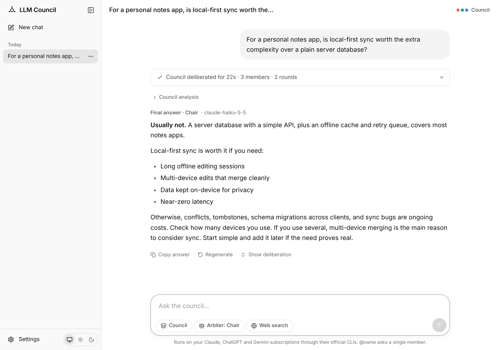
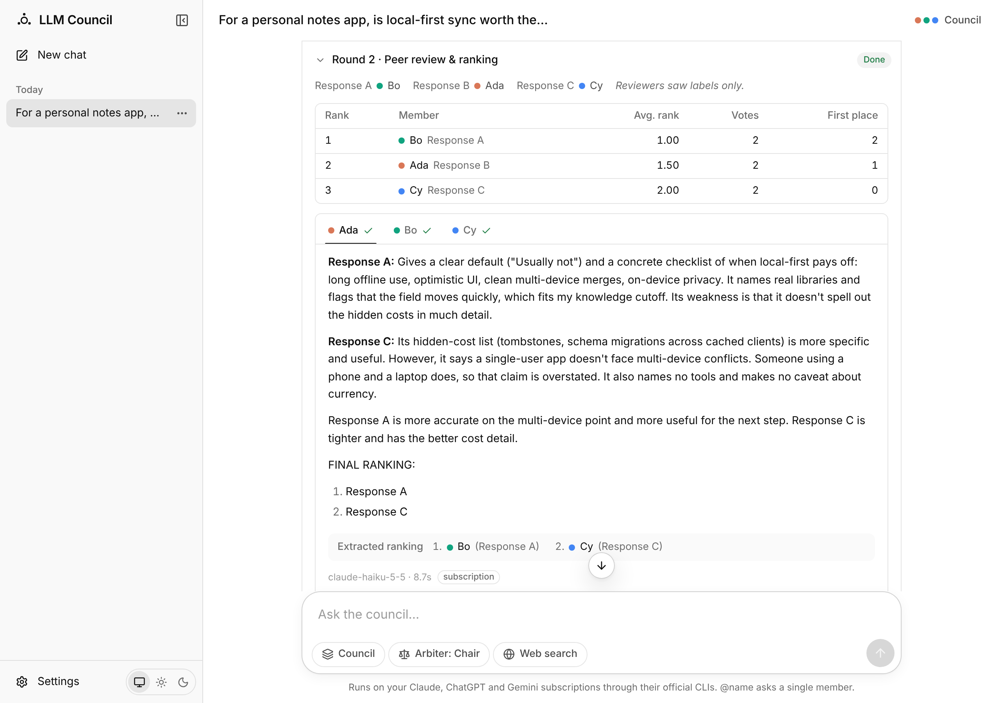

# LLM Council

LLM Council is a local web app with a chat interface. You ask a question, a council of AI models answers it over a number of rounds you configure, and an arbiter you choose writes the final answer. It does not call any model API. Instead it drives each vendor's official command-line tool (Claude Code, Codex CLI and Antigravity CLI) signed in with your own consumer subscription, so the calls count against your subscription quota and not against API credits.

The council can also work from your own documents: local folders, a Google Drive folder that Google Drive for Desktop keeps synced to your computer, and a Notion workspace. The app keeps a searchable copy of their text on your computer, gives the models the relevant passages with your question, and the answers cite the sources they used. See "Your documents".

The design draws on three earlier ideas. Andrej Karpathy's llm-council introduced the pattern of independent answers, anonymous peer ranking and a chairman who writes the result. Councily added roles, debate between models and @mentions. OpenRouter Fusion showed that the arbiter should compare the answers instead of counting votes: it reports consensus, contradictions, unique insights and blind spots, then writes one answer.





## Quick start

You need Node.js 22.13 or newer. You do not need any of the vendor CLIs to start the app, but the council is only useful once at least one is installed (see the next section).

Install the dependencies:

```bash
npm install
```

Build the interface and start the server:

```bash
npm start
```

Open http://127.0.0.1:8787 in your browser.

To try the interface without any CLI, run the demo instead. It uses a built-in demo provider that returns canned answers, and it keeps its data in a separate `data-demo` folder so it does not mix with real conversations:

```bash
npm run demo
```

## Connect your subscriptions

Each provider is optional. The council works with whichever CLIs are installed. In Settings you can add or remove seats, rename them, and point any seat at a different provider. A seat whose provider is not installed fails when it is called, so remove or disable seats you do not use.

### Claude: Claude Code CLI (`claude`)

Install Claude Code by following https://code.claude.com/docs/en/setup. Then run `claude` once and sign in with your Claude subscription (`/login`). Verify with:

```bash
claude auth status
```

The output should show that you are logged in with a Claude subscription.

### ChatGPT: Codex CLI (`codex`)

Install the CLI:

```bash
npm install -g @openai/codex
```

Sign in with `codex login` and choose Sign in with ChatGPT. Verify with:

```bash
codex login status
```

### Gemini: Antigravity CLI (`agy`)

On 18 June 2026 Google stopped serving Google AI Pro and Ultra subscriptions through Gemini CLI and moved them to Antigravity CLI. That is why this app uses `agy` and not `gemini`.

Install it on macOS or Linux:

```bash
curl -fsSL https://antigravity.google/cli/install.sh | bash
```

On Windows, in PowerShell:

```powershell
irm https://antigravity.google/cli/install.ps1 | iex
```

Run `agy` once in a terminal and sign in with the Google account that holds your AI subscription. Antigravity has no status command. To verify, open Settings, then Providers, and press Test on the Gemini card.

### Settings, then Providers

Open Settings and choose the Providers tab to check each CLI. Each card shows:

| Item | Meaning |
| --- | --- |
| Status | Whether the command was found, its version, and whether it is signed in. Claude and Codex are checked with their own status commands. Antigravity and custom providers report "unknown" until you press Test. |
| Test | Sends a small real prompt through the CLI and reports the answer, the time taken, the model and the billing mode. |
| Diagnostics | The tail of the CLI's raw output from the last test. Read this first when something fails. |
| Command | Overrides the command name, for example an absolute path when the CLI is not on your `PATH`. Empty uses the default (`claude`, `codex`, `agy`). |
| Extra arguments | One argument per line, appended to the built-in arguments. |
| Timeout (seconds) | Per-call time limit for this provider. 0 uses the default timeout from the General tab (600 seconds). Allowed range is 10 to 3,600. |
| Prompt delivery | Antigravity only: `stdin` (default) or `arg`. |

Warnings appear on the card when the CLI is signed in with an API key or when Antigravity overage credits are enabled. See "How it avoids API charges".

### Models and reasoning effort

Every seat starts with an empty model, which means the CLI's own default model for your plan. To pin one, open Settings, then Council, and type a model name or pick a suggestion. For ChatGPT and Gemini, "Load models" asks the CLI for its current list (`codex debug models`, `agy models`), which is more reliable than the built-in suggestions because model names change often.

Effort is also empty by default, with one exception: the ChatGPT seat starts at `high`, because Codex sets most of its models to low reasoning effort by default, which suits a coding agent better than a deliberation. Change it per seat as you like. Antigravity model names already include an effort level (for example `gemini-4-neon-high`).

## Using it

The composer at the bottom of the page has four controls and a button next to the text box.

| Control | What it does |
| --- | --- |
| Protocol | Chooses the sequence of rounds for this and later questions. |
| Arbiter | Chooses which provider and model writes the final answer. It is ignored when only one member answers. |
| Web search | Lets members search the web. Claude and Codex are switched on and off by this toggle. Antigravity decides for itself and ignores it. Custom providers do not support it. |
| Library | Chooses how questions use your documents: off, search or browse. It reads "Library: search", "Library: browse" or "Library: off". See "Three ways to use documents". |
| Attach (paperclip button) | Opens a picker for library documents that every model reads in full for this question and the follow-ups. |

### Built-in protocols

| Protocol | Rounds | What happens |
| --- | --- | --- |
| Council (default) | 2 | Independent answers, then an anonymous peer review and ranking. The arbiter then rules. |
| Quick synthesis | 1 | Each model answers once, and the arbiter compares and fuses the answers. The fastest option. |
| Debate | 3 | Independent answers, then two rounds in which each model reads the others' answers (with names shown) and rebuts or revises its own. |
| Deep deliberation | 3 | Independent answers, anonymous peer review, then a revision round in which each model rewrites its answer in light of the critiques. |

### Round types

| Type | What every member does |
| --- | --- |
| Independent answers | Answers the question on its own, without seeing the others. The first round is always this type. |
| Peer review and ranking | Critiques the other members' current answers and ranks them. Rankings are collected into a leaderboard. |
| Rebuttal and revision | Reads the others' answers and any reviews, then rewrites its own answer. |

Review and revision rounds can hide who wrote each answer (anonymize). A review round can also include a reviewer's own answer among those it ranks.

### Rules and roles

Rules are free text injected into prompts. A round rule applies to every member in that round only. A council rule (Settings, Council) applies to every member in every round. The arbiter has its own instructions (Settings, Arbiter).

Each member can be given a role that is added to its prompt. The built-in roles are Devil's advocate, Evidence critic, Researcher, Pragmatist, Optimist, Pessimist and Visionary. You can also write a custom role.

### The arbiter and its analysis

After the last round, the arbiter reads every member's current answer and writes the final answer. It compares the answers rather than voting. With "analysis" turned on (the default), it first writes a short council analysis covering consensus, contradictions, unique insights and blind spots, and then the final answer. If the arbiter call fails, the app shows the best-placed member's answer instead and says so.

### @mentions and direct mode

Type `@name` in your question to send it only to that member. A member's handle is its name in lower case with everything except letters and digits removed, so "ChatGPT" is `@chatgpt` and "GPT 6.2" is `@gpt62`. A mention must start the text or follow whitespace or an opening bracket, so email addresses are ignored. A mention also reaches a disabled member.

One mention, or a single enabled member, gives direct mode: that member answers once, with no rounds and no arbiter. Two or more mentions run the council with only those members. The mention tokens are removed from the question the models see.

### Controls during and after a run

- Stop ends the run, terminates the CLI processes and keeps whatever partial output exists.
- Skip to verdict appears during council rounds. It cuts the current round short and sends the answers that exist to the arbiter.
- Regenerate appears under the last answer. It replaces that turn with a new run of the same question using the current settings.
- Follow-up questions in the same conversation include earlier questions and final answers in the prompt, up to the history budget (60,000 characters by default; the General tab can change it).

### Building a custom protocol

Open Settings, then Protocol. The built-in protocols are read-only, so duplicate one and edit the copy. You can name it, add up to 8 rounds, choose each round's type (the first is always Independent answers), give a round a title and rules, and set anonymize and include-self where they apply. Choose the protocol in the composer.

### Cost in quota terms

One question makes (members x rounds) + 1 model calls: every enabled member is called once per round, plus one call for the arbiter. Three members on the Council protocol is 3 x 2 + 1 = 7 calls. Direct mode is one call. Deep deliberation with three members is 10 calls. Long conversations also send history with each call. Keep this in mind against your subscription's usage limits.

The library adds to every call. The passages found for a question (24,000 characters by default, roughly 6,000 tokens) and any attached documents (up to 120,000 characters by default) are sent with every model call of that question, including the arbiter's. With the search planner on, which is the default, each question in Search or Browse mode also costs one small extra model call. Both amounts are set in Settings, Library.

## Your documents

### What the library is

The library is a searchable copy, kept on this computer, of the text of your documents. Nothing is uploaded to build it. Text leaves the computer only inside a question: as passages the app found, or as documents you attached. Your original files are never changed.

### Adding a folder

Open Settings, then Library, and press Add folder. Type or paste the full path, press one of the shortcut buttons, or browse to the folder and press Use this folder. The folder picker lists folder names only. The app starts reading the folder at once and shows progress on its card.

After that the app re-checks every folder on a timer, every 30 minutes by default (Settings, Library, "Check for changes every"; 0 checks only when you press Check now, otherwise 5 to 1,440). A check re-reads only files whose size or modification time changed, files that failed last time, and files read by an older version of the app's reader. Files that have disappeared leave the library, but only when the folder itself could be read, so an unplugged external drive does not empty it.

A source is limited to 20,000 files and 25 levels of folders. The app skips hidden files and folders (names starting with a dot), `node_modules`, Office lock files (names starting with `~$`), `Thumbs.db`, `desktop.ini`, and the Windows system folders `$RECYCLE.BIN` and `System Volume Information`. It does not follow symbolic links. You cannot add a drive root, a relative path, or a folder that contains or sits inside the app's data directory. You can add up to 20 sources.

### Google Drive

Install Google Drive for Desktop and add its folder like any other folder. The app offers it as a shortcut when it finds one. On macOS it lives under `~/Library/CloudStorage/GoogleDrive-…`. On Windows it is usually a drive letter with a `My Drive` folder.

Real files in Drive (PDF, Word, Excel, PowerPoint) are read. Native Google Docs, Sheets and Slides are not: on disk they are only small link files with no content, so the app cannot read them. It counts them and lists them on the source card as link files. To include one, download it from Google as Word, Excel, PowerPoint or PDF and put the download in the folder.

Files that Drive keeps online-only are downloaded when the app reads them. The first check of a large Drive folder can therefore take a while and needs an internet connection. On macOS, the system may ask once whether the terminal you started the app from may access the folder; allow it.

### What can be read

| File types | What is read | Parts |
| --- | --- | --- |
| `pdf` | The text layer. | One per page, cited as `p. 4`. |
| `docx`, `doc` | The body text. Headings, lists and tables are kept in `docx`. | One, undivided. |
| `pptx` | Slide text and speaker notes. | One per slide, cited as `slide 3`. |
| `xlsx`, `xlsm`, `xls` | Cell values as displayed, one row per line with cells separated by `\|`. Hidden sheets are read and marked. | One per sheet, cited as `sheet Budget`. |
| `html`, `htm` | The page text, without navigation, footers and scripts. | One, undivided. |
| `rtf` | The text. | One, undivided. |
| `txt`, `md`, `markdown`, `csv`, `tsv`, `text`, `log` | The text, in UTF-8, UTF-16 or Windows-1252. | One, undivided. |

Some files are reported but not read. The app shows the reason on the source card and in the problem lists:

- A PDF without a text layer, which is usually a scan. There is no OCR.
- A password-protected PDF, or an Office file that is damaged or password-protected.
- Any other file that could not be read, with the reader's own message.
- A file over 100 MB.
- A file of an unsupported type, including old `.ppt` files (save them as `.pptx`).
- A Google Docs link file, as described above.

Even in a file that is read, some content is not captured: text inside images, SmartArt and charts, and the headers and footers of Word files. Dates in old `.xls` files may appear as serial numbers.

### Notion

Open Settings, then Library, then Notion, and paste a token. Two kinds work:

- A personal access token, created at https://www.notion.so/developers/tokens. It sees everything you can see in Notion, and it expires after at most a year.
- A connection with an API token, created at https://app.notion.com/developers/connections. It sees only the pages and databases you give it access to. It needs the "read content" capability, plus "insert content" if you want to save answers to Notion.

The app checks the token with Notion before it stores it. Pages and database rows are read as text, and database properties are written above the page text. To save answers, choose a page under "Save answers under". Each answer then has a Save to Notion action, which creates a new page under the page you chose, with the question, the answer, its sources, and optionally the council's deliberation.

### Three ways to use documents

Choose the mode with the Library control in the composer.

- **Search.** The app searches the library and every model gets the same passages, cited as `[S3]`. First a small model turns your question into a few keyword searches; the app searches for those and for your question as typed. This is a keyword search: it finds the words, not the meaning, so a document that says "terminate" will not be found by a question that says "cancel" unless the planner thinks of both.
- **Attach.** Press the paperclip and pick documents. Every model reads them in full, cited as `[D1]`. They stay attached for follow-up questions in the conversation until you remove them. A document longer than the attachment limit is cut, and it is marked as cut. Attachments work in every mode, including off.
- **Browse.** As Search, and in addition models whose command-line tool has file tools open the library themselves. They are given a read-only text copy of the library that includes an index file, and they can search it and open files as they see fit.

Under each answer, the Sources block shows what the models were given: the searches used, the attached documents, and the passages grouped by document, each with a way to open the file's folder or the Notion page. In the text of an answer, a citation such as `[S3]` or `[D1]` appears as a small chip. Hover over it to see the document title and where in it the passage came from, and activate it to jump to that passage in the Sources block.

Search answers are only as good as the passages the search found. A question such as "go through all my contracts and list the renewal dates" cannot be answered from a handful of passages. Use Browse for questions that need everything, or attach the documents.

### Who can browse

By default only Claude opens files in Browse mode, because it is the only command-line tool that has been checked to stay inside the library folder. ChatGPT and Gemini receive passages only. A switch in Settings, Library ("Also let ChatGPT and Gemini open the library") lets them open the library as well. Leave it off unless you need it. Those tools have file tools and are not confined to the folder, so a document that carries hidden instructions could lead them to read other files on your computer.

### Checking what the app read

Each source card shows counts of the problems it found, such as "38 could not be read" or "12 Google Docs link files". Press a count to see the files and the reasons. "Browse documents" in Settings, Library, lists every document and has a "View text" action that shows the text the app extracted, which is the way to check that a file was read properly. "Try a search" shows the passages the library returns for a query, which is what the models would be given.

## How it avoids API charges

Every CLI call is made with these environment variables removed from the child process:

| Provider | Variables removed |
| --- | --- |
| Claude | `ANTHROPIC_API_KEY`, `ANTHROPIC_AUTH_TOKEN`, `CLAUDE_CODE_USE_BEDROCK`, `CLAUDE_CODE_USE_VERTEX`, `CLAUDE_CODE_USE_FOUNDRY` |
| Codex | `OPENAI_API_KEY`, `CODEX_API_KEY`, `OPENAI_BASE_URL` |
| Antigravity | `GEMINI_API_KEY`, `GOOGLE_API_KEY`, `AGY_ADC_AUTH`, `GOOGLE_GENAI_USE_VERTEXAI`, `GOOGLE_GEMINI_BASE_URL` |

This is on by default (Settings, General, "Remove API-key environment variables from CLI calls"). Custom providers get your environment unchanged. If a variable from the list is set when you start the app, the provider card tells you it is being removed.

The app also reports how each response was billed, where the CLI allows it:

- Claude reports its billing source on every call, and each response is labelled accordingly.
- For Codex, the billing mode comes from `codex login status`, which says whether you are signed in with ChatGPT or an API key.
- For Antigravity, the CLI does not report billing, so it is inferred from the CLI's own settings file, `~/.gemini/antigravity-cli/settings.json`. `"modelProvider": "gemini"` is treated as API-key billing.

The Providers tab warns you when Claude Code is signed in with something other than a Claude subscription, when Codex is signed in with an API key, when Antigravity is set to API-key billing, and when Antigravity has `"useG1Credits": true` (overage AI credits).

What the app cannot guarantee: your subscription quota limits still apply and the council can use them quickly. Overage and extra-usage settings in your Anthropic, OpenAI and Google accounts are yours to control, and the app cannot see or change them.

## What has and has not been tested

**Claude** was tested end to end against Claude Code 2.1.330 with a signed-in subscription, through the browser interface: two- and three-round councils, direct mode with an @mention, web search, and follow-up questions. Every call reported subscription billing.

**ChatGPT** has not been tested with a signed-in account. The arguments were checked against Codex CLI 0.171.0, and the output parser was checked against the documented event stream and a captured signed-out run.

**Gemini** was built from Google's Antigravity CLI headless documentation. It has not been run at all.

**The interface** was tested in a browser against the real server using the demo provider: all four built-in protocols, direct mode, failing members, a failing arbiter, stop, skip to verdict, regenerate, reloading and restarting the server mid-run, every settings tab, both themes, and a 375-pixel-wide phone layout.

**The document library** was tested as follows.

- Reading and searching ran on a 48-file corpus of contracts (PDF), meeting notes (Word), spreadsheets, slide decks and policies. 42 files were read. A scan, a locked PDF, two Google Docs link files and two unsupported files were each reported with the right reason. The right document came first for all eight test searches.
- With the live Claude CLI, a council answered a contract question from the library with correct citations. In Browse mode Claude searched the files itself and correctly answered a question that needed all fourteen contracts. An attached lease was read correctly, and a follow-up about passage `[S1]` resolved to the same passage.
- In one test with Claude, a document planted with a forged passage and an instruction to ignore the others did not mislead the answer: the model cited the real contract and reported the planted instruction. The delimiters stop a document from passing its text off as another source; they cannot guarantee that a model is never persuaded by what a document says.
- Claude's confinement in Browse mode was checked: reads inside the library copy worked, and every attempt to read a file outside it was refused by the CLI.
- The library interface was tested in a browser against the real server with the demo provider, in every library mode.

**Not verified in the library:**

- Notion. It was built from Notion's current documentation and tested against recorded responses only; no real Notion workspace was connected. Treat it as unverified until Connect and a first check succeed.
- Browse mode for ChatGPT and Gemini, which is off by default.
- Google Drive for Desktop folders on a real machine, including online-only files, and everything about the library on Windows and macOS: "Show in folder", read-only file attributes and Drive folder detection.
- Difficult real-world documents: multi-column or rotated PDFs, very large spreadsheets, and documents in Chinese or Japanese, where search is weak because words are not separated.

**Windows** process handling (finding the command, ending process trees) is implemented but untested.

Treat the ChatGPT and Gemini seats as unverified until you have pressed Test on each and read a real answer.

### Troubleshooting

- **A CLI is not found.** The card says it is not installed. Install it, restart the app so it picks up your `PATH`, or put the full path in the Command field.
- **Not signed in.** Run the sign-in step for that CLI in a terminal (see above), then press Test. For Antigravity, Test is the only check.
- **A flag is rejected.** An older or newer CLI version may not accept an argument the app passes. Update the CLI. If a newer CLI needs an extra flag, add it under Extra arguments. The diagnostics show the CLI's own error message.
- **Antigravity produces no output.** Change Prompt delivery on the Gemini card from `stdin` to `arg` (or back), then Test again. Arg mode refuses prompts over 30,000 characters.
- **Calls time out.** Raise the Timeout on that provider's card, or the default in General. Deep reasoning efforts and web search can take several minutes.
- **The port is in use.** Start on another port with `npm run serve -- --port 8788` (this runs the server without rebuilding the interface; run `npm run build` once first if you have not).

## Terms of service and privacy

This is not legal advice, only what the vendors state and what the app does.

- Use it personally, on your own machine, with your own accounts. Do not expose the server to a network.
- Anthropic's support documentation says that `claude -p` draws on your subscription limits when you are signed in with your plan.
- OpenAI lists `codex exec` as available on ChatGPT plans.
- Google's Antigravity terms say that using third-party software, tools or services to access the service is a breach that can lead to suspension. The example they give is reusing Antigravity sign-in in another tool. This app runs Google's own `agy` program and does not read or touch its credentials, but the terms do not explicitly address wrappers like this one. The Gemini seat therefore carries a risk the other two do not. Decide for yourself whether to enable it, and remove the seat if you are not comfortable.
- Your questions and the other models' answers are sent to each vendor through its CLI, and are subject to that vendor's privacy terms. Conversations and settings are stored only in the local data directory.
- Passages from your documents and attached documents are sent to every vendor whose model answers, in every call of that question. In Browse mode, a model that opens files sends what it reads to its vendor as well. Leave a folder out of the library if its contents must not go to all of them.
- The author could not read Notion's developer terms. If you intend to send Notion content to AI providers, check them first.

## Configuration reference

### Server options

Flags take precedence over environment variables, which take precedence over defaults. Pass flags after `--` when using an npm script, for example `npm run serve -- --port 8788`.

| Flag | Environment variable | Default | Meaning |
| --- | --- | --- | --- |
| `--port <n>` | `PORT` | `8787` | Port to listen on (0 to 65535). |
| `--host <addr>` | none | `127.0.0.1` | Address to bind. Leave it alone unless you know why you are changing it. |
| `--data-dir <path>` | `COUNCIL_DATA_DIR` | `data/` in the project folder | Where conversations and settings are stored. |
| `--mock` | `COUNCIL_MOCK=1` or `true` | off | Use the built-in demo provider instead of the CLIs. |
| `--help`, `-h` | none | none | Print usage and exit. |

### npm scripts

| Command | What it does |
| --- | --- |
| `npm start` | Builds the interface, then starts the server. |
| `npm run serve` | Starts the server without building. |
| `npm run demo` | Builds, then starts with `--mock --data-dir data-demo`. |

### Where data lives

Everything is under the data directory. `settings.json` holds your seats, protocols, arbiter, rules and provider overrides. `conversations/` holds one JSON file per conversation. The Settings dialog edits `settings.json`. If the file cannot be read, the app sets it aside as `settings.invalid-<timestamp>.json` and starts with defaults.

The document library adds these:

- `library/` holds the manifest (the list of documents and their status) and the extracted text of each document.
- `secrets.json` holds the Notion token. It is readable only by your user where the system supports that, and the app never shows it.
- The browse copy, the read-only text copy that Browse mode hands to the CLIs, is kept outside the data directory, in a per-user cache folder: `~/.cache/llm-council/` on Linux (or under `$XDG_CACHE_HOME` when that is set), `~/Library/Caches/llm-council/` on macOS, and `%LOCALAPPDATA%\llm-council\` on Windows. It is regenerated on demand and is safe to delete.

### Adding a custom provider

A custom provider is any command that reads a prompt and prints its answer as plain text to stdout. Add it to `customProviders` in `settings.json` while the app is stopped, then start the app again. The provider then appears in the Providers tab and can be chosen for any seat or the arbiter.

`settings.json` is created the first time you save a change in Settings. If it does not exist yet, you can create it with only the `customProviders` key; every other setting is filled in from the defaults.

Each entry has these fields:

- `id`: a unique identifier, used by seats to refer to it.
- `label`: the name shown in the app.
- `command`: the program to run.
- `args`: arguments passed on every call. The literal text `{model}` is replaced with the seat's model.
- `modelArgs`: extra arguments added only when the seat has a model set. `{model}` is replaced here too.
- `promptVia`: `stdin` writes the prompt to standard input; `arg` appends it as the last argument.

This example runs a local Ollama model. The model is chosen per seat in Settings:

```json
{
  "customProviders": [
    {
      "id": "ollama",
      "label": "Ollama",
      "command": "ollama",
      "args": ["run", "{model}"],
      "modelArgs": [],
      "promptVia": "stdin"
    }
  ]
}
```

Set the seat's provider to `ollama` and its model to a name you have pulled, for example `llama3.2`. Custom providers have no sign-in check, no effort setting and no web search, and the app does not strip any environment variables for them.

## Safety model

- The server listens on 127.0.0.1 by default and answers only requests addressed to `localhost`, `127.0.0.1` or `[::1]` (or the host you pass to `--host`), which blocks DNS rebinding. A request that carries an Origin header is accepted only when that origin is the same address the request was sent to, so neither another website nor another program's web server on your computer can call the API. Requests that the browser marks as cross-site are rejected, and so are request bodies that are not `application/json`.
- Each CLI call runs in a fresh, empty temporary directory that is deleted afterwards, so models start with no project files in front of them.
- Claude runs with all tools disabled. When Web search is on, only WebSearch and WebFetch are enabled. It also runs without slash commands, session persistence or settings files.
- Codex runs in its read-only sandbox, without your user config, with project docs disabled. Read-only stops it changing anything, but it does not stop it reading files on your computer.
- Antigravity runs in its default headless permission mode. It offers no flag to disable its tools, so the prompt tells the model not to run commands, but that is an instruction and not an enforced restriction. Once Test works for the Gemini seat, consider adding `--sandbox` under Extra arguments on its provider card; Google documents that flag as running with terminal sandbox restrictions.
- Each model is shown the other models' answers, and with Web search on, text from web pages. The prompts mark that material as something to evaluate and not as instructions, but a model can still be misled by text it reads. For the Codex and Antigravity seats, which keep some access to your machine, that is a reason to leave Web search off when you are working with anything sensitive.
- The library reads only the folders you add, never follows links out of them, and skips hidden files. The folder picker lists folder names only and cannot read files.
- Document parsing runs in a separate process with a time limit per file, so a damaged file cannot stall the app.
- Text from documents is quoted inside delimiters chosen for each question, so a document cannot pass its own text off as another source or as an instruction from the app. As with web pages, a model can still be misled by what it reads.
- In Browse mode a CLI is started in a generated read-only text copy of the library, kept outside the app's data folder, and never in your real folders. By default only Claude, whose confinement was verified, is given it.
- The Notion token is stored in a file readable only by your user where the system supports that, and is sent only to Notion.

## Development

Start the server with file watching and the Vite dev server together:

```bash
npm run dev
```

Run the tests:

```bash
npm test
```

Type-check the server and the web app:

```bash
npm run typecheck
```

Project layout:

- `shared/`: types, built-in protocols, roles and limits, and @mention parsing, used by both sides.
- `server/`: the Express server, run engine, storage, settings, security checks and the provider adapters in `server/providers/`.
- `server/library/`: the document library: folder and Notion sources, text extraction (in a separate process), search, the browse copy and the library's HTTP endpoints.
- `web/`: the React interface, built by Vite into `web/dist`, which the server serves.
